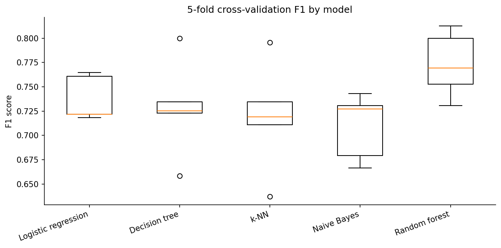
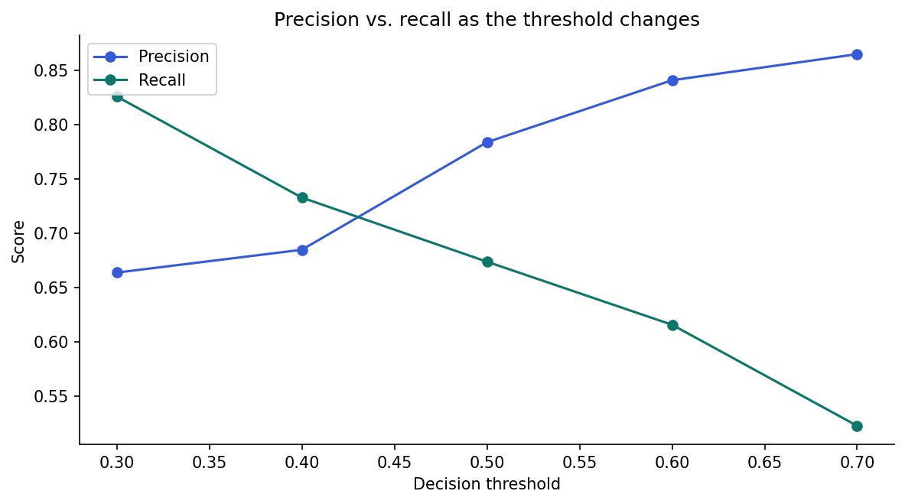
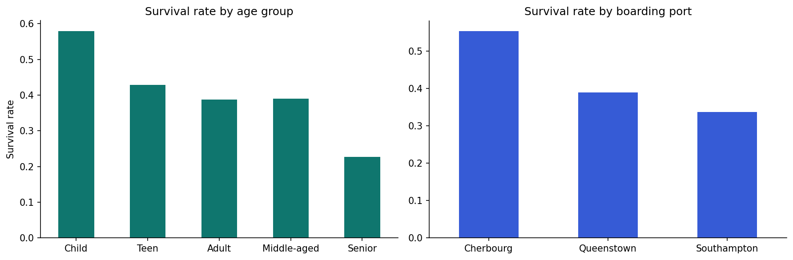

# Titanic Survival: End-to-End Data Mining

A complete, honest data-mining workflow on the 891-passenger Titanic dataset: data quality checks, a confounding analysis, association rules built from scratch, five classifiers compared with cross-validation, decision-threshold tuning, and a single final test evaluation.

**Author:** Oluwatoyin Olawale Akadiri · [Portfolio](https://oluwatoyinakadiri.com) · [LinkedIn](https://www.linkedin.com/in/oluwatoyin-akadiri/)

## Results at a glance

| Analysis | Result |
|---|---|
| Tuned random forest (held-out test set) | **83.9% accuracy**, F1 0.772 (cross-validated F1 0.775) |
| Strongest association rule | Adult women in 1st class → survived: **97% confidence, lift 2.54** |
| Rescue-scenario threshold (0.3) | **Recall 0.83**, catching the most survivors |
| Confounding check | The Cherbourg survival advantage is explained mostly by **passenger class**, not port |

## Key findings

1. **Check for confounders before reading patterns as causes.** Cherbourg passengers survived 55% of the time vs 34% from Southampton, but half of Cherbourg passengers travelled first class.
2. **Association rules surface clear, explainable patterns.** Support, confidence, and lift are computed directly in pandas, without extra libraries.
3. **The threshold is a business decision.** Lowering it from 0.5 to 0.3 raises recall from 0.67 to 0.83.
4. **Not every feature helps.** Adding passenger titles slightly lowered cross-validated F1, so the simpler model was kept.







## Methods

- Data quality report: missing values by column (Cabin 77%, Age 20%)
- Group-wise imputation of age by class and sex
- Association rule mining with support, confidence, and lift
- Logistic regression, decision tree, k-NN, Naive Bayes, and random forest compared with 5-fold CV
- `GridSearchCV` tuning on training data only; one final test evaluation
- Feature importance and a feature-engineering experiment

## Project structure

```
titanic-survival-data-mining/
├── notebooks/titanic_survival_data_mining.ipynb   # full analysis with outputs
├── images/                                        # charts used in this README
├── requirements.txt
└── README.md
```

## How to run

```bash
git clone https://github.com/Tropy007/titanic-survival-data-mining.git
cd titanic-survival-data-mining
pip install -r requirements.txt
jupyter notebook notebooks/titanic_survival_data_mining.ipynb
```

The notebook downloads the public Titanic dataset automatically.

## Limitations and ethics

The model learns from a single historical event and reflects the social rules of 1912. It is a demonstration of method, not a tool for decisions about real people.
